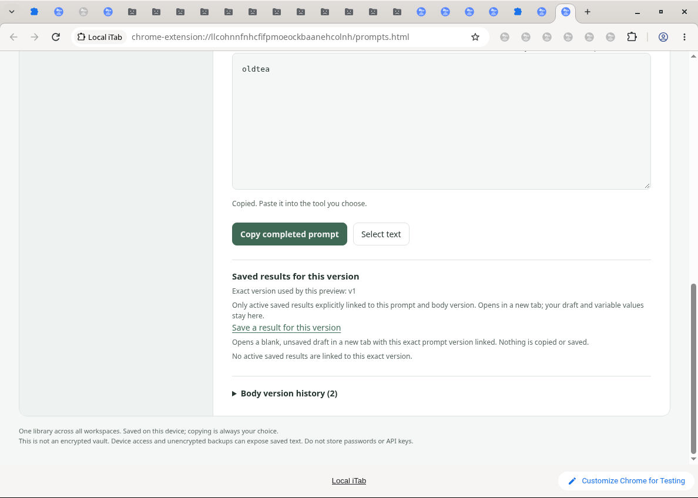

# Historical prompt preview acceptance

Dot cloud Chrome for Testing, 2026-10-11. Synthetic local fixtures only.

- Explicit historical reuse and return retain isolated tea/coffee variable values.
- Selecting a history row alone does not change the active preview.
- Real copy and native paste verify oldtea and newcoffee respectively.
- A new explicitly saved result links to the actual historical version; current-version scope excludes it.
- Clear returns to the current version and clears active/current values without increasing saved history.
- Keyboard activation, preview focus, excerpt Escape focus and dark theme passed.

Automated integration: 1,725 Node and 53 Python tests; independent historical-preview audit: 18 adversarial cases.

Not covered by native checks: quota exhaustion, injected storage failures, asynchronous races, complete restore, screen reader, narrow screen, or unsaved source editor. These bounds must not be read as all-platform acceptance.

