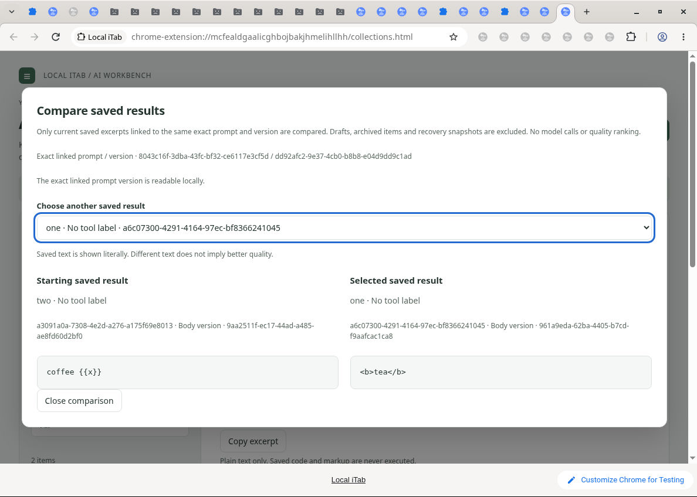

# Saved-result comparison acceptance

Dot cloud Chrome for Testing, 2026-10-11. Synthetic local fixtures only.

Native checks passed:
- Explicit selection compares literal saved bodies for the exact same prompt/version IDs.
- Different-version and archived candidates are excluded.
- Separate editor draft title/body survive opening, selecting and closing comparison.
- Equal saved bodies receive an honest equality notice.
- Keyboard selection, Escape and focus restoration work.
- A cross-tab archive invalidates stale comparison; reopening excludes the archived record.
- Dark theme and 200% zoom stacked reflow, including keyboard Close, work.

Integrated automation: 1,733 Node and 53 Python tests pass. Independent audit: 132 targeted tests, including 10 adversarial cases, pass.

Bounds: native long-body overflow, physical narrow-window resizing, screen-reader use and cross-platform installation were not tested. Automated tests cover long Unicode/literal content, stale events, read failures, unavailable source labels and disposal. Reflow at 200% is not a physical viewport-size measurement.

